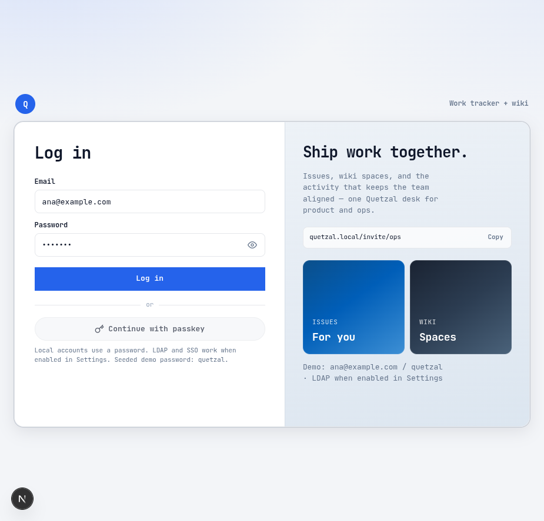
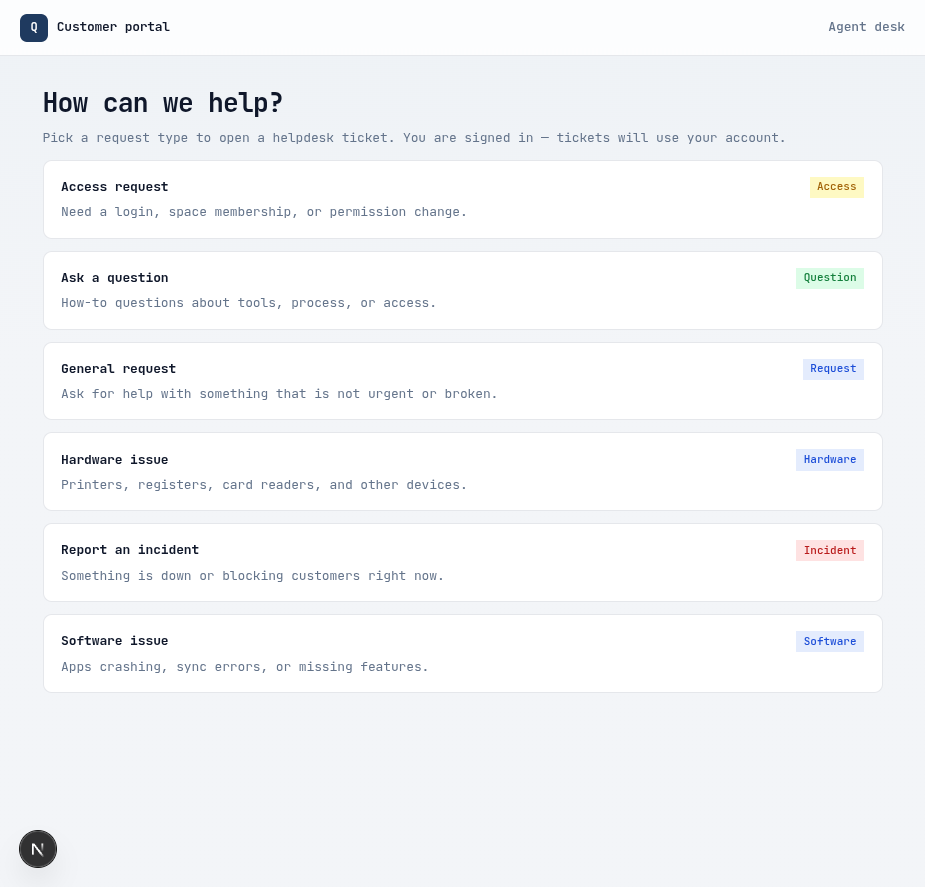
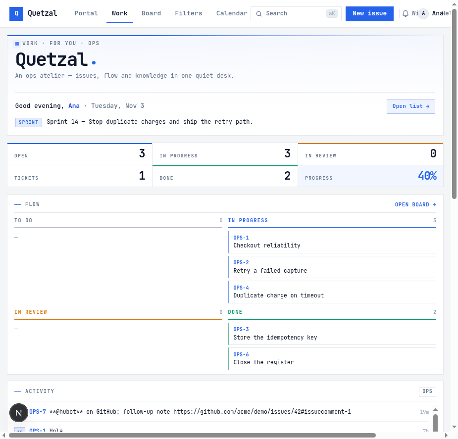
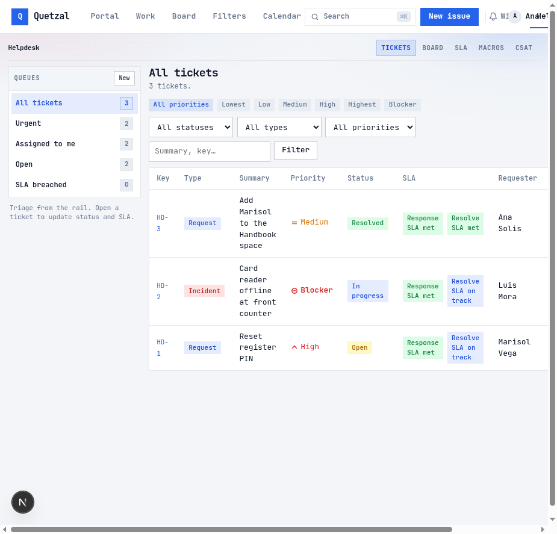

# Quetzal

Open-source **work · wiki · helpdesk** desk for a small company. **Apache-2.0**.

**GitHub:** [github.com/tobbikz/quetzal](https://github.com/tobbikz/quetzal) · release **v0.1.0**

Not Atlassian, and **not** the Hacienda / facturación “Quetzal FE” product.



## 5-minute quickstart (Docker)

```bash
git clone https://github.com/tobbikz/quetzal.git
cd quetzal
cp .env.example .env
# Edit .env: set QUETZAL_PG_PASSWORD + QUETZAL_AUTOMATION_CRON_SECRET (long random)
docker compose up --build -d
curl -fsS http://127.0.0.1:3210/api/health
```

Open:

| Surface | URL |
|---------|-----|
| App / login | http://127.0.0.1:3210/login |
| Portal | http://127.0.0.1:3210/portal |
| Mailpit (captured mail) | http://127.0.0.1:8025 |
| Health | http://127.0.0.1:3210/api/health |

Seeded demo login (after first boot with `QUETZAL_SEED_PASSWORDS=1`): **`ana@example.com` / `quetzal`**.

Smoke script:

```bash
export QUETZAL_AUTOMATION_CRON_SECRET="$(grep QUETZAL_AUTOMATION_CRON_SECRET .env | cut -d= -f2-)"
./scripts/docker-smoke.sh
```

## Screenshots

| Login | Portal |
|-------|--------|
|  |  |

| Work | Helpdesk |
|------|----------|
|  |  |

## What you get

- **Work** — projects, issues, board, QQL filters, calendar, roadmap, releases, dashboards  
- **Wiki** — spaces, page tree, templates  
- **Helpdesk** — agent desk, SLA, macros, CSAT, portal  
- **Integrations** — webhooks, Slack/Teams, GitHub sync, email inbound API  
- **Auth** — local scrypt passwords, optional LDAP/SSO  

## Local dev (without Docker app)

```bash
cp .env.example .env
npm install
export QUETZAL_DATABASE_URL='postgresql://…/quetzal'
npm run migrate
npm run dev   # http://127.0.0.1:3210
```

## Production notes

- Compose runs **`NODE_ENV=production`** and forces `QUETZAL_DEMO_AUTH=0` / `QUETZAL_QUICK_LOGIN=0`
- Cron container hits `POST /api/automation/tick` every **15 minutes** (Bearer secret)
- Default SMTP is **Mailpit**; point `QUETZAL_SMTP_*` at your provider for real mail
- GitHub outbound comments need a **fresh** `QUETZAL_GITHUB_TOKEN` (never commit it)
- Ops: [`docs/go-live.md`](docs/go-live.md) · auth: [`docs/ops-auth-integrations.md`](docs/ops-auth-integrations.md)

## License

Apache License 2.0 — see [`LICENSE`](LICENSE).
